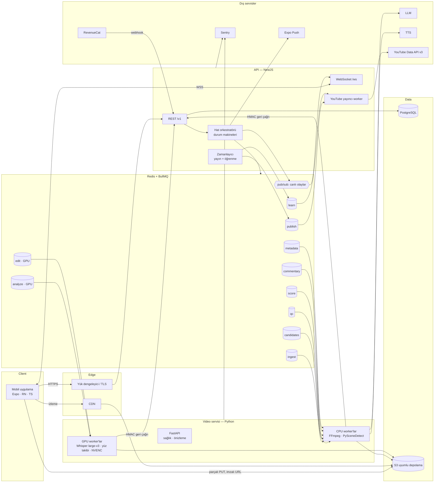
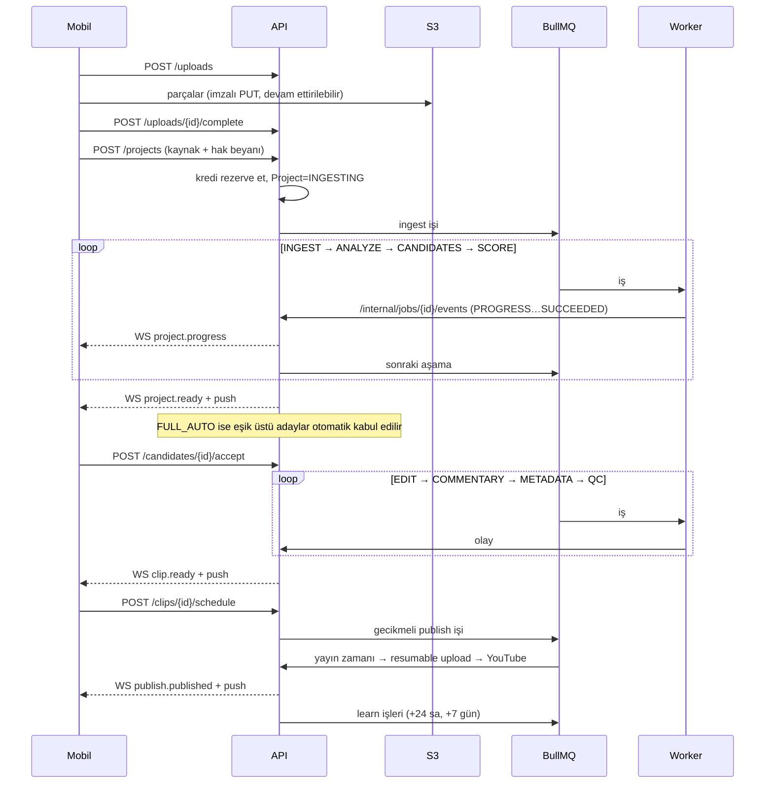
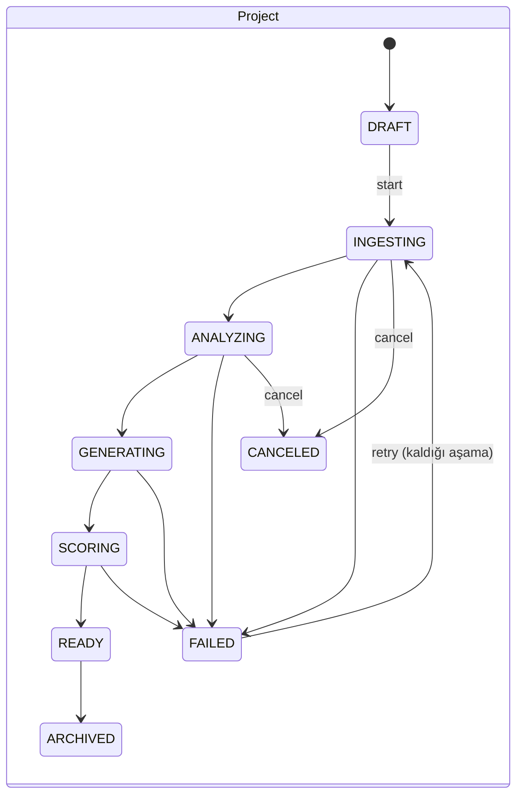
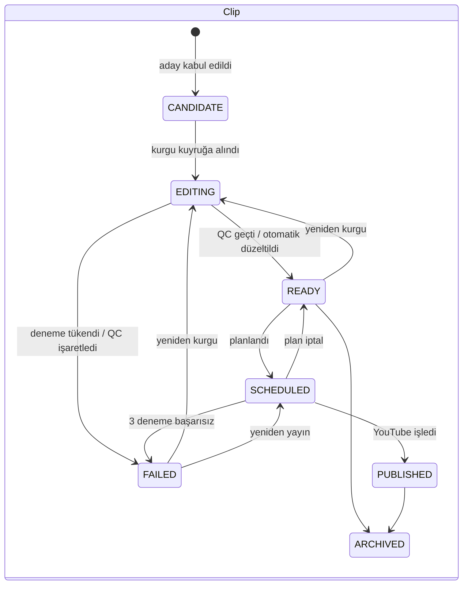
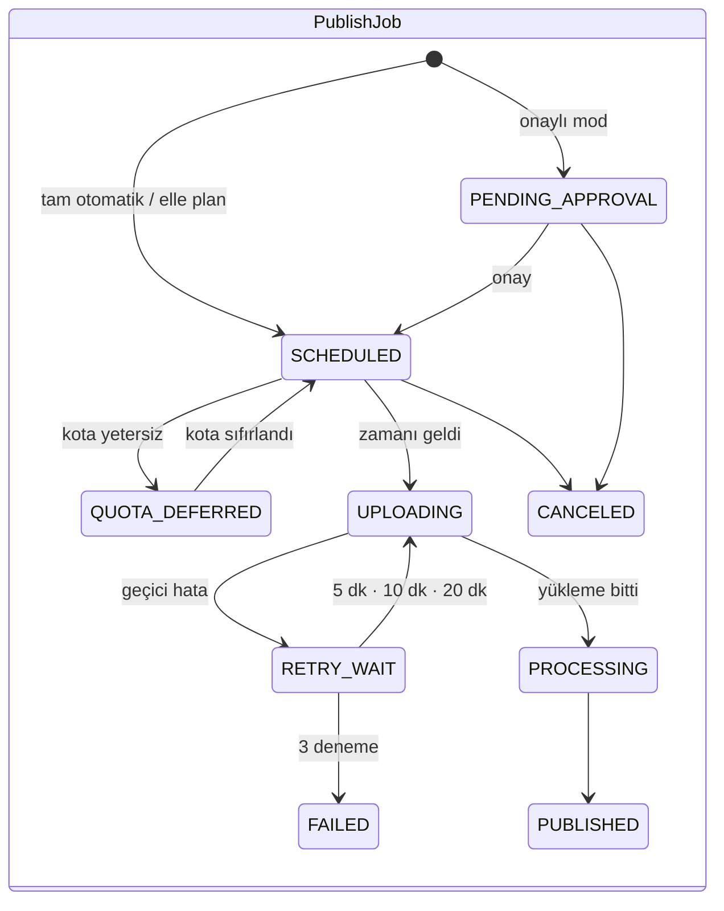
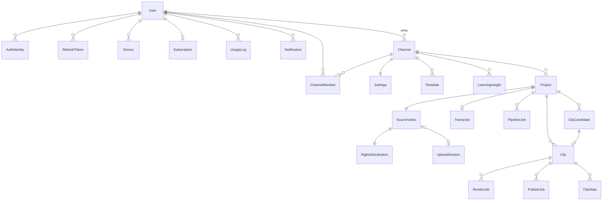

# KlipAI — Aşama 1: Mimari

İlgili dosyalar:
- Veritabanı şeması: [`apps/api/prisma/schema.prisma`](../apps/api/prisma/schema.prisma)
- REST sözleşmesi: [`docs/api/openapi.yaml`](api/openapi.yaml)
- WebSocket sözleşmesi: bu belgenin 6. bölümü

## 1. Mimari şema



### Bir projenin akışı



## 2. Mimari kararlar

| # | Karar | Gerekçe |
|---|---|---|
| 1 | pnpm + Turborepo monorepo | Mobil ve API aynı Zod sözleşmesini (`packages/shared`) paylaşır; tip kayması olmaz. |
| 2 | Orkestrasyon API'de, işlem worker'da | Durum makinesi tek yerde (PostgreSQL) yaşar; worker'lar durumsuz ve yatayda ölçeklenir. |
| 3 | Python worker'lar BullMQ'yu resmi `bullmq` Python istemcisiyle tüketir | Öncelik, yeniden deneme ve gecikmeli iş için ikinci bir kuyruk sistemi gerekmez. |
| 4 | Worker → API bildirimi HMAC imzalı HTTP geri çağrısı | Worker'lara veritabanı erişimi verilmez; sır yüzeyi küçülür. |
| 5 | Her aşama ayrı kuyruk | GPU ve CPU havuzları bağımsız ölçeklenir, bir aşama diğerlerini tıkamaz. |
| 6 | Aşama çıktıları S3'te, anahtarları DB'de | Yeniden deneme önceki aşamayı tekrar çalıştırmaz (idempotent, devam edilebilir). |
| 7 | Dosya yükleme istemciden doğrudan S3'e (multipart, imzalı URL) | 20 GB'lık dosya API'den geçmez; parça bazında devam ettirilir. |
| 8 | Klip düzeni `editSpec` JSON'unda | Editör yalnızca tarif değiştirir; render sunucuda deterministik tekrar üretilir. |
| 9 | Access token 15 dk + dönen refresh token (aile iptali) | Çalınan refresh token tekrar kullanıldığında tespit edilip tüm oturum zinciri kapatılır. |
| 10 | OAuth token'ları AES-256-GCM, anahtar ortam sırrında/KMS'te | Veritabanı sızıntısı tek başına kanal erişimi vermez. |
| 11 | Kredi = işlenen kaynak dakikası, yalnızca eklemeli `UsageLog` defteri | Denetlenebilir; iade ve rezervasyon aynı defterde tutulur. |
| 12 | 60 dk → 10 dk hedefi: ses 16 kHz'e indirilir, 10 dk'lık parçalara bölünüp GPU'larda paralel Whisper (faster-whisper, batched); sahne/yüz tespiti 720p proxy üzerinde eşzamanlı | Analiz süresi video süresinden bağımsızlaşır, GPU sayısıyla ölçeklenir. |
| 13 | Bildirim metinleri i18n anahtarı + parametre olarak saklanır | Aynı kayıt TR ve EN gösterilir; dil değişince geçmiş de çevrilir. |
| 14 | Hak beyanı değiştirilemez ve kullanıcı silinse de saklanır | Telif ihtilafında hukuki kanıt; KVKK'da "hukuki yükümlülük" istisnası. |

### Plan sınırları

| | Ücretsiz | Pro | Ajans |
|---|---|---|---|
| Klip/ay | 5 | 150 | sınırsız |
| Kredi (işlenen dk)/ay | 60 | 1.800 | 12.000 (adil kullanım) |
| Azami çözünürlük | 720p | 1080p | 4K |
| Kanal | 1 | 1 | 10 |
| Filigran | var | yok | yok |
| Ekip erişimi | — | — | var |
| Kuyruk önceliği (1 = en yüksek) | 5 | 3 | 1 |

Kredi kotaları şartnamede yoktu; birim maliyete göre seçilmiş varsayımdır, `packages/shared/src/plans.ts` içinde tek yerden değişir.

## 3. Kuyruklar

| Kuyruk | Çalıştıran | Eşzamanlılık | Deneme | Geri çekilme | Zaman aşımı |
|---|---|---|---|---|---|
| `ingest` | Python CPU | 8 | 3 | üstel 30 sn | 30 dk |
| `analyze` | Python GPU | GPU başına 1 | 3 | üstel 60 sn | 15 dk |
| `candidates` | Python CPU | 8 | 3 | üstel 10 sn | 2 dk |
| `score` | Python CPU (LLM) | 16 | 4 | üstel 15 sn | 5 dk |
| `edit` | Python GPU | GPU başına 2 | 3 | üstel 60 sn | 10 dk |
| `commentary` | Python CPU (LLM+TTS) | 16 | 3 | üstel 15 sn | 3 dk |
| `metadata` | Python CPU (LLM) | 16 | 3 | üstel 15 sn | 3 dk |
| `qc` | Python CPU | 8 | 2 | sabit 10 sn | 3 dk |
| `publish` | NestJS | 4 | 3 | üstel 5 dk | 30 dk |
| `learn` | NestJS | 4 | 5 | üstel 10 dk | 2 dk |
| `notifications` | NestJS | 16 | 5 | üstel 5 sn | 30 sn |
| `maintenance` | NestJS (cron) | 1 | 1 | — | 10 dk |

İş kimliği `{stage}:{projectId|clipId}:{attempt}` biçimindedir; aynı aşama iki kez kuyruğa girmez. Tükenen işler `failed` kümesinde 7 gün tutulur.

## 4. Durum makineleri







Geçişler `apps/api/src/common/state-machine.ts` içindeki tek tablodan doğrulanır; geçersiz geçiş `409 INVALID_STATE` döner. Güncellemeler `UPDATE … WHERE status = <beklenen>` ile atomiktir.

Otomasyon modunun etkisi:

| Mod | Aday kabulü | Yayın |
|---|---|---|
| Tam otomatik | eşik üstü ilk N aday otomatik | QC geçince otomatik planlanır |
| Onaylı | eşik üstü ilk N aday otomatik | `PENDING_APPROVAL`, kullanıcı onaylar |
| Sadece taslak | kullanıcı seçer | kullanıcı planlar |

## 5. Yetki matrisi

| İşlem | Sahip | Editör | İzleyici |
|---|---|---|---|
| Proje / klip / takvim / istatistik görüntüleme | ✓ | ✓ | ✓ |
| Proje oluşturma, klip düzenleme, render | ✓ | ✓ | — |
| Planlama, onay, yayın iptali | ✓ | ✓ | — |
| Kanal ayarları, şablonlar | ✓ | ✓ | — |
| Üye yönetimi, kanal bağlantısını kesme | ✓ | — | — |

Kredi ve klip hakkı her zaman kanal sahibinin aboneliğinden düşer.

## 6. WebSocket sözleşmesi

- Uç nokta: `wss://api.klipai.app/ws` (Socket.IO v4, yalnızca `websocket` taşıması).
- Kimlik: el sıkışmada `auth: { token: <accessToken> }`; süresi dolunca sunucu `auth.expired` yollar, istemci yenileyip tekrar bağlanır.
- Odalar sunucu tarafından atanır: `user:{id}` ve üyesi olunan her `channel:{id}`. İstemci ayrıntılı ilerleme için `subscribe` ile `project:{id}` odasına girer.
- Her olayın zarfı: `{ id, type, ts, data }`. İstemci yeniden bağlanırken `lastEventId` yollar; sunucu Redis Stream'den son 5 dakikayı tekrar oynatır, daha eskisi için istemci React Query önbelleğini geçersiz kılar.

İstemci → sunucu:

| Olay | Gövde | Yanıt (ack) |
|---|---|---|
| `subscribe` | `{ projectId }` | `{ ok: true }` \| `{ ok: false, code }` |
| `unsubscribe` | `{ projectId }` | `{ ok: true }` |

Sunucu → istemci:

| `type` | `data` |
|---|---|
| `project.progress` | `{ projectId, status, stage, stageProgress, progress, etaSec }` |
| `project.ready` | `{ projectId, candidateCount, topScore }` |
| `project.failed` | `{ projectId, stage, error: { code, message } }` |
| `candidate.scored` | `{ projectId, candidateId, score }` |
| `clip.progress` | `{ clipId, projectId, stage, progress }` |
| `clip.updated` | `{ clipId, status, qcStatus, version }` |
| `clip.ready` | `{ clipId, thumbnailUrl, needsApproval }` |
| `clip.failed` | `{ clipId, stage, error }` |
| `publish.updated` | `{ publishJobId, clipId, status, uploadProgress, nextAttemptAt }` |
| `publish.published` | `{ publishJobId, clipId, youtubeVideoId, youtubeUrl }` |
| `publish.failed` | `{ publishJobId, clipId, error }` |
| `quota.updated` | `{ channelId, used, limit, resetAt }` |
| `credits.updated` | `{ used, granted, clipsUsed }` |
| `notification.created` | `Notification` (OpenAPI şeması) |
| `auth.expired` | `{}` |

İlerleme olayları iş başına saniyede en çok 1 kez yayılır.

## 7. Depolama düzeni

```
s3://klipai-{env}/
  uploads/{userId}/{uploadId}/{dosyaAdı}          orijinal kaynak (30 gün sonra soğuk katman)
  projects/{projectId}/proxy.mp4                  720p analiz proxy'si
  projects/{projectId}/audio.wav                  16 kHz mono
  projects/{projectId}/analysis/{words,scenes,energy,faces}.json
  projects/{projectId}/previews/{candidateId}.mp4
  clips/{clipId}/v{n}/{output.mp4,thumb.jpg,commentary.mp3}
  brand/{channelId}/{logo,watermark,intro,outro}.*
  rights/{declarationId}/evidence.*               ayrı kova politikası, silinmez
  exports/{userId}/{requestId}.zip                7 gün sonra silinir
  music/{genre}/{trackId}.mp3                     telifsiz müzik kütüphanesi
```

Tüm nesneler özeldir; istemci yalnızca kısa ömürlü imzalı CDN URL'leri alır.

## 8. Klasör yapısı

```
klipai/
├── package.json · pnpm-workspace.yaml · turbo.json · tsconfig.base.json
├── docker-compose.yml                  postgres, redis, minio, api, video-cpu, video-gpu
├── .env.example
├── .github/workflows/                  ci.yml · deploy-staging.yml · deploy-prod.yml · mobile-eas.yml
├── docs/
│   ├── 01-mimari.md
│   ├── api/openapi.yaml
│   └── store-checklist.md              (Aşama 7)
├── packages/
│   └── shared/                         API + mobil ortak
│       └── src/  enums.ts · plans.ts · schemas/ (zod) · ws-events.ts · error-codes.ts
├── apps/
│   ├── api/                            NestJS
│   │   ├── Dockerfile
│   │   ├── prisma/  schema.prisma · migrations/ · seed.ts
│   │   ├── test/                       e2e
│   │   └── src/
│   │       ├── main.ts · app.module.ts
│   │       ├── config/                 env doğrulama (zod)
│   │       ├── common/                 guards, filters (problem+json), interceptors, crypto, state-machine, idempotency
│   │       ├── prisma/ · redis/ · storage/ (S3, imzalı URL)
│   │       ├── auth/                   e-posta, Google, JWT, refresh rotasyonu
│   │       ├── users/                  profil, cihazlar, KVKK dışa aktarma/silme
│   │       ├── channels/               OAuth bağlama, ayarlar, üyeler, kota
│   │       ├── uploads/                multipart oturumları
│   │       ├── projects/               proje, kaynak, hak beyanı, adaylar
│   │       ├── clips/                  klip, editSpec, render tetikleme
│   │       ├── pipeline/               orkestratör, kuyruk tanımları, internal olay ucu
│   │       ├── publishing/             zamanlayıcı, YouTube istemcisi, resumable upload, kota
│   │       ├── learning/               istatistik çekme, içgörü üretimi
│   │       ├── templates/ · stats/ · notifications/ (push + merkez)
│   │       ├── billing/                RevenueCat webhook, krediler, yetki denetimi
│   │       ├── realtime/               Socket.IO gateway, Redis adaptörü
│   │       └── health/
│   └── mobile/                         Expo (TypeScript)
│       ├── app.config.ts · eas.json
│       ├── app/                        Expo Router
│       │   ├── _layout.tsx
│       │   ├── (auth)/  welcome · login · register · forgot-password
│       │   ├── (onboarding)/  connect-channel
│       │   ├── (tabs)/  index (panel) · calendar · stats · templates · settings
│       │   ├── project/  new (sihirbaz) · [id]/index (ilerleme) · [id]/candidates
│       │   ├── clip/[id].tsx           editör
│       │   ├── subscription.tsx · notifications.tsx
│       │   └── oauth/youtube.tsx       derin bağlantı dönüşü
│       └── src/
│           ├── api/                    istemci, React Query kancaları, token yenileme
│           ├── realtime/               socket + önbellek eşitleme
│           ├── stores/                 Zustand: auth, tema, taslaklar (kalıcı), yükleme kuyruğu
│           ├── upload/                 parçalı, devam ettirilebilir, arka planda
│           ├── components/ · theme/ (koyu/açık) · i18n/ (tr.json, en.json)
│           ├── offline/                taslak kuyruğu ve sürüm çakışması çözümü
│           └── lib/                    purchases (RevenueCat), push, sentry
└── services/
    └── video/                          Python 3.12
        ├── Dockerfile.cpu · Dockerfile.gpu · pyproject.toml
        ├── tests/
        └── klipai_video/
            ├── main.py                 FastAPI (sağlık, metrikler)
            ├── worker.py               BullMQ tüketicileri (kuyruk → aşama)
            ├── config.py · storage.py · callback.py (HMAC) · costs.py · ffmpeg.py
            ├── stages/  ingest · analyze · candidates · score · edit · commentary · metadata · qc
            ├── ai/      whisper · scenes · diarization · faces · llm · tts
            ├── render/  crop (yüz takibi) · subtitles (ASS, kelime kelime) · effects · audio (LUFS, ducking) · compose
            └── prompts/ score.md · commentary_{reaction,analysis,ranking}.md · metadata.md · learning.md
```

## 9. Veri modeli özeti



Şartnamedeki 14 modele ek olarak: `AuthIdentity`, `RefreshToken`, `OneTimeToken`, `Device`, `ChannelMember`, `UploadSession`, `PipelineJob`, `ClipStats`, `LearningInsight`, `Notification`, `DataRequest`. İndeksler ve alan açıklamaları şema dosyasındadır.
