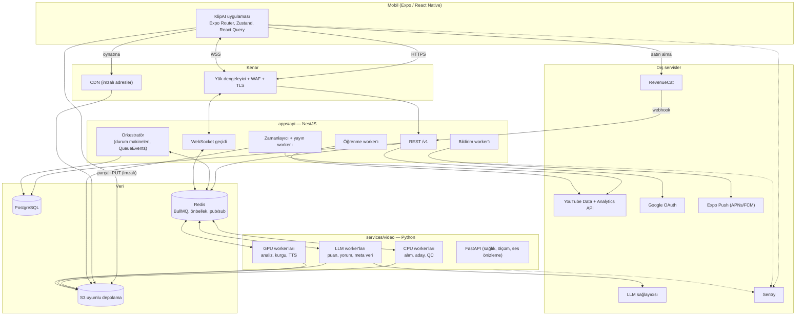
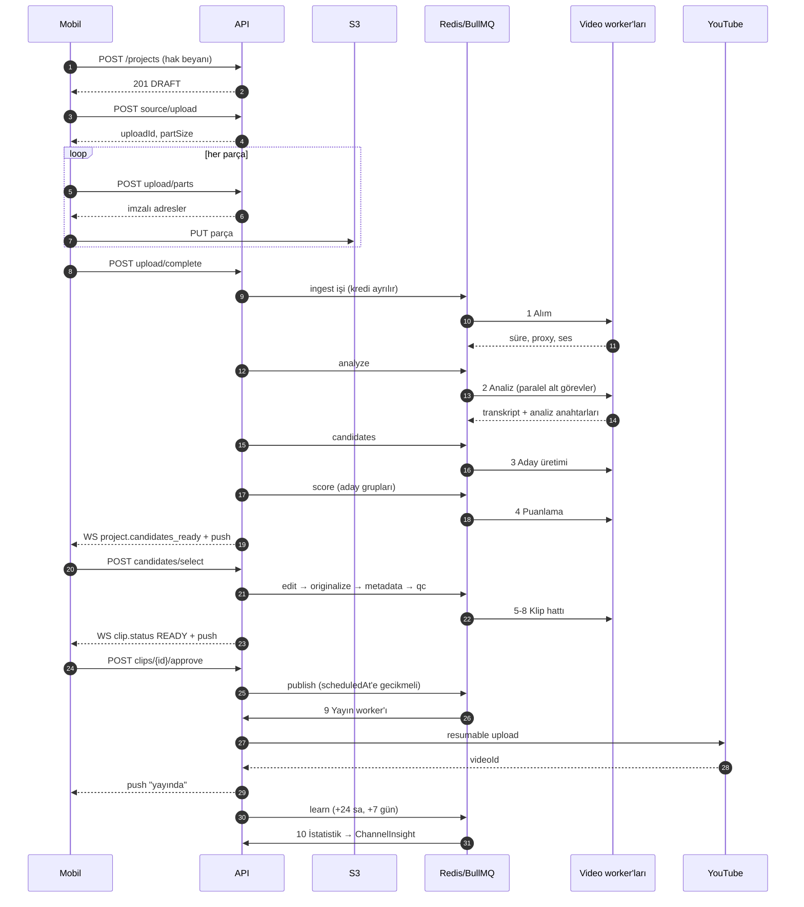

# KlipAI — Mimari

Yol: `klipai/docs/01-mimari.md`

## 1. Sistem şeması

## 2. Bileşen sorumlulukları

| Bileşen | Sorumluluk | Ölçekleme |
|---|---|---|
| `apps/mobile` | Arayüz, parçalı yükleme, çevrimdışı taslak, push | — |
| `apps/api` (HTTP) | Kimlik, yetki, doğrulama, hız sınırı, imzalı adres, plan/kredi denetimi | Yatay, durumsuz |
| `apps/api` (worker) | Orkestrasyon, yayın, öğrenme, bildirim, bakım işleri | Yatay; aynı imaj, `ROLE=worker` |
| `services/video` | Tüm medya ve yapay zeka işleri | Kuyruk derinliğine göre otomatik (GPU havuzu ayrı) |
| PostgreSQL | Kalıcı durum. **Yalnızca API yazar.** | Birincil + okuma kopyası |
| Redis | BullMQ kuyrukları, hız sınırı sayaçları, WS yayını, olay akışları | Kuyruk ve önbellek için ayrı örnek (prod) |
| S3 + CDN | Kaynak, proxy, analiz çıktıları, klipler, kapaklar | — |

## 3. Temel mimari kararlar

| # | Karar | Gerekçe |
|---|---|---|
| 1 | pnpm + Turborepo monorepo | Paylaşılan tipler ve durum makineleri tek yerden gelir, CI yalnızca değişen paketi kurar. |
| 2 | Python worker'lar BullMQ'yu resmi `bullmq` Python paketiyle doğrudan tüketir | Tek kuyruk altyapısı; öncelik, yeniden deneme ve gecikmeli iş her iki dilde aynı davranır, HTTP zaman aşımı sorunu olmaz. |
| 3 | Postgres'e yalnızca NestJS yazar; worker sonucu iş dönüş değeri + S3 anahtarı olarak verir | Şema ve durum geçişleri tek kod tabanında kalır, Python tarafı durumsuz ve kolay ölçeklenir. |
| 4 | Orkestrasyon API'de, `QueueEvents` ile; BullMQ Flow yerine açık durum makinesi | Aşamalar arasında kullanıcı kararı (aday seçimi, onay) bulunduğu için akış tek bir iş ağacına sığmaz. |
| 5 | Proje başlarken ayarların anlık görüntüsü alınır | Devam eden iş sonradan değişen ayardan etkilenmez, sonuç yeniden üretilebilir olur. |
| 6 | Büyük çıktılar (kelime zaman damgaları, yüz izleri) S3'te, tabloda yalnızca anahtar | 60 dakikalık videoda on binlerce satır yerine tek nesne; tablo küçük ve hızlı kalır. |
| 7 | OAuth token'ları ayrı tabloda, AES-256-GCM ile şifreli, sürümlü anahtarlık | Sızan veritabanı yedeği tek başına kanal erişimi vermez; anahtar rotasyonu `keyVersion` ile yapılır. |
| 8 | Refresh token rotasyonu + aile bazlı yeniden kullanım tespiti | Çalınan token ilk kullanımda fark edilir ve tüm oturum zinciri kapanır. |
| 9 | REST doğruluk kaynağı, WebSocket yalnızca tazeleme sinyali | Bağlantı kopsa bile durum tutarsızlığı oluşmaz. |
| 10 | Kredi defteri yalnızca eklenir, `idempotencyKey` tekildir | Yeniden denenen iş iki kez faturalanmaz, her kredi hareketi denetlenebilir. |
| 11 | Kredi analiz başında ayrılır, başarısızlıkta iade edilir | Kullanıcı bakiyesini aşan iş hiç başlamaz, başarısız iş ücretlendirilmez. |
| 12 | LLM çağrıları sağlayıcıdan bağımsız arayüz arkasında, yapılandırılmış JSON çıktı + şema doğrulama | Model değişimi kod değişikliği gerektirmez, bozuk çıktı kuyruğa girmeden yakalanır. |
| 13 | Bağlantıdan alım yalnızca doğrudan medya adresleri | Video platformlarından sayfa adresiyle indirme o platformların kullanım koşullarını ihlal eder ve mağaza reddine yol açar. |
| 14 | Hata biçimi RFC 9457, kararlı `code` alanı | İstemci metne değil koda göre davranır, metinler TR/EN yerelleştirilir. |
| 15 | Kaçan kuyruk olayları dakikalık bakım işiyle telafi edilir | Orkestratör kapalıyken biten iş kaybolmaz; hat hiçbir durumda yarıda takılı kalmaz. |
| 16 | Uygulama sahibi `OWNER_EMAILS` ile tanımlanır | Tek kullanıcılı kurulumda abonelik gerekmeden tüm özellikler sınırsız açılır; abonelik altyapısı ileride başka kullanıcılar için hazır kalır. |
| 17 | UUIDv7 birincil anahtar | Zamana göre sıralı olduğu için indeks parçalanmaz ve imleçli sayfalamada doğrudan kullanılır. |

## 4. Kuyruk topolojisi

Her aşama ayrı kuyruk ve ayrı iştir; bağımsız yeniden denenir. Öncelik plandan gelir
(Ajans 1, Pro 5, Ücretsiz 10).

| Kuyruk | Aşama | Worker | Eşzamanlılık | Deneme / geri çekilme | Zaman aşımı |
|---|---|---|---|---|---|
| `ingest` | 1 Alım: indirme, ffprobe, proxy + ses çıkarma | Python CPU | 4 | 3 / üstel 30 sn | 30 dk |
| `analyze` | 2 Analiz: Whisper, sahne, enerji, konuşmacı, yüz | Python GPU | GPU başına 1 | 2 / üstel 60 sn | 15 dk |
| `candidates` | 3 Aday üretimi | Python CPU | 8 | 3 / sabit 10 sn | 2 dk |
| `score` | 4 LLM puanlama | Python LLM | 16 | 4 / üstel 5 sn | 5 dk |
| `edit` | 5 Kurgu | Python GPU | GPU başına 2 | 2 / üstel 30 sn | 10 dk |
| `originalize` | 6 Yorum metni + TTS + yeniden kurgu | Python GPU | GPU başına 2 | 3 / üstel 15 sn | 10 dk |
| `metadata` | 7 Başlık, açıklama, etiket, kapak | Python LLM | 16 | 4 / üstel 5 sn | 3 dk |
| `qc` | 8 Kalite kontrol + otomatik düzeltme | Python CPU | 8 | 2 / sabit 10 sn | 5 dk |
| `publish` | 9 YouTube yükleme | Node | 10 | 3 / üstel 1-2-4 dk | 30 dk |
| `learn` | 10 İstatistik çekme (24 sa / 7 gün gecikmeli) | Node | 5 | 5 / üstel 10 dk | 2 dk |
| `notify` | Push + uygulama içi bildirim | Node | 20 | 5 / üstel 10 sn | 30 sn |
| `maintenance` | Kota sıfırlama, dönem yenileme, yarım yükleme temizliği, KVKK işleri | Node | 2 | 3 | 30 dk |

Ortak kurallar:

- İş kimliği belirleyicidir (`{stage}_{projectId}` veya `{kind}_{clipId}_{specHash}`); aynı iş iki kez kuyruğa girmez.
- İş yükü yalnızca kimlik ve S3 anahtarı taşır; medya asla Redis'e yazılmaz.
- Worker ilerlemeyi `job.updateProgress` ile bildirir; orkestratör bunu Postgres'e ve WebSocket'e yansıtır.
- Kalıcı hatalar (bozuk dosya, desteklenmeyen kodek) `UnrecoverableError` ile yeniden denenmez.
- Denemeleri tükenen iş `failed` kümesinde 7 gün kalır; kullanıcı `POST /projects/{id}/retry` ile sürdürür.

## 5. Uçtan uca akış

Otomasyon moduna göre fark:

- **Tam otomatik:** 4. aşamadan sonra `minScore` eşiğini geçen en iyi `maxClipsPerVideo` aday kendiliğinden seçilir; QC'den geçen klip onaysız planlanır. `FLAGGED` klip planlanmaz, onay bekler.
- **Onaylı:** Aday seçimi kendiliğinden yapılır, klip `READY` durumunda onay bekler.
- **Sadece taslak:** Adaylar listelenir; seçim ve planlama tümüyle kullanıcıdadır.

## 6. Performans bütçesi (60 dk video → 10 dk içinde analiz)

Aşama 2 tek iş olarak görünür ama içeride paralel çalışır:

| Adım | Yöntem | Hedef süre |
|---|---|---|
| Proxy + ses çıkarma (aşama 1) | Donanım hızlandırmalı ffmpeg, 540p proxy, 16 kHz mono ses | 1,5 dk |
| Transkript | faster-whisper large-v3, VAD ile ~30 sn'lik parçalar, toplu çıkarım (batch 16, fp16) | 2,5 dk |
| Kelime hizalama + konuşmacı ayrımı | wav2vec2 hizalama, pyannote; transkriptle aynı GPU'da ardışık | 1,5 dk |
| Sahne tespiti | PySceneDetect, proxy üzerinde, kare atlamalı; CPU'da transkriptle eşzamanlı | 1 dk |
| Ses enerjisi | ffmpeg `ebur128` + RMS, 100 ms pencere; CPU'da eşzamanlı | 0,3 dk |
| Yüz tespiti | Proxy'den saniyede 2 kare, toplu GPU çıkarımı | 1 dk |
| Aday üretimi + puanlama | Adaylar 10'luk gruplar halinde 16 eşzamanlı LLM çağrısı | 1,5 dk |
| **Toplam (duvar saati)** | CPU adımları GPU adımlarıyla örtüşür | **≈ 8 dk** |

Hedefin tutması için GPU kuyruğunda bekleme 1 dakikayı aşmamalıdır; otomatik ölçekleme
`analyze` kuyruğundaki en eski işin yaşına göre tetiklenir. Yüz **takibi** (kare kare) analizde
değil, yalnızca seçilen kliplerde kurgu aşamasında yapılır.

## 7. Güvenlik

| Konu | Uygulama |
|---|---|
| Sırlar | Yalnızca backend ortam değişkenleri / gizli yönetici (OAuth şifreleme anahtarları dahil; sürümlü anahtarlık `TOKEN_ENC_KEYS`). Uygulamada yalnızca herkese açık anahtarlar (RevenueCat SDK anahtarı, Sentry DSN, Google istemci kimliği). |
| OAuth | Yetkilendirme kodu + PKCE; kod takası sunucuda. Token'lar şifreli, yalnızca yayın/öğrenme worker'ı çözer. |
| Kimlik | Argon2id parola özeti; 15 dk erişim JWT'si (HS256; token'ı yalnızca API doğruladığı için simetrik anahtar yeterlidir); 30 gün döner refresh token, sunucuda özeti saklanır. |
| Yetki | Her kanal kaynağında üyelik + rol denetimi (`packages/shared` içindeki `PERMISSIONS`). |
| Girdi | Tüm DTO'lar zod ile doğrulanır; bilinmeyen alanlar reddedilir; gövde sınırı 1 MB. |
| Hız sınırı | Redis kayan pencere: IP başına (kimlik uçları 10/dk), kullanıcı başına (genel 300/dk, yükleme başlatma 20/saat). |
| Yükleme | İmzalı adresler tek nesne anahtarına, içerik türüne ve boyuta bağlı; 30 dk geçerli. Tamamlamada sunucu boyutu ve türü yeniden doğrular. |
| İndirme | Depolama özeldir; oynatma kısa ömürlü imzalı CDN adresiyle yapılır. |
| Bağlantıdan alım | Yalnızca HTTPS, DNS çözümü sonrası özel/yerel IP reddi, yönlendirme ve boyut sınırı. |
| Webhook | RevenueCat başlığı sabit zamanlı karşılaştırma + olay kimliğiyle idempotensi. |
| KVKK/GDPR | Dışa aktarma (zip, 7 gün), silme (30 gün bekleme, ardından veritabanı + depolama + YouTube token iptali). Hak beyanı ve kişisel veri içermeyen denetim kaydı yasal dayanakla saklanır. |

## 8. İzleme ve maliyet

- **Log:** JSON (pino / structlog); her satırda `traceId`, `userId`, `projectId`, `jobId`. `traceId` API isteğinden kuyruk işine ve worker'a taşınır.
- **Sentry:** Mobil, API ve video servisi; sürüm ve ortam etiketiyle, kişisel veriler temizlenerek.
- **Ölçümler (Prometheus):** kuyruk derinliği ve en eski iş yaşı, aşama süreleri (p50/p95), GPU doluluk, LLM token sayısı, yayın başarı oranı, kota kullanımı.
- **İş başına maliyet:** Her worker sonucu `gpuSeconds`, LLM giriş/çıkış token'ı ve TTS karakter sayısını döndürür; orkestratör birim fiyat tablosuyla `costUsd` hesaplar ve `PipelineJob` / `RenderJob` / `UsageLog` satırlarına yazar. Proje ve plan başına birim maliyet buradan raporlanır.

## 9. Ortamlar

| | dev | staging | prod |
|---|---|---|---|
| Çalıştırma | `docker compose` (Postgres, Redis, MinIO) | Konteyner kümesi, 1 GPU düğümü | Konteyner kümesi, otomatik ölçeklenen GPU havuzu |
| Yapay zeka | Küçük Whisper modeli, CPU; `AI_MOCK=1` ile sabit yanıt | Üretimle aynı modeller | Üretim |
| YouTube | Test kanalı, yüklemeler gizli | Test kanalı | Gerçek |
| RevenueCat | Sandbox | Sandbox | Üretim |
| Dağıtım | — | `main` dalına her birleştirmede | Sürüm etiketi + elle onay |

## 10. Yayın öncesi bilinmesi gereken dış kısıtlar

1. **YouTube API denetimi:** Google'ın uyumluluk denetiminden geçmemiş API projelerinden yüklenen videolar gizli (private) kalmaya zorlanır. Herkese açık yayın için denetim başvurusu mağaza çıkışından önce tamamlanmalıdır.
2. **YouTube kotası:** Varsayılan kota proje başına günde 10.000 birimdir ve tüm kullanıcılar arasında paylaşılır. Yükleme maliyeti yapılandırmadan okunur (`YT_UPLOAD_QUOTA_COST`); kota artışı başvurusu gerekir. Zamanlayıcı hem proje hem kanal düzeyinde kotayı izler ve dolunca yayınları ertesi güne erteler.
3. **Hassas OAuth kapsamları:** `youtube.upload` kapsamı Google OAuth doğrulaması gerektirir (gizlilik politikası, alan adı doğrulaması, tanıtım videosu).
4. **Hak beyanı hukuki koruma sağlamaz:** Beyan kayıt altına alınır, ancak telifli film/dizi kesitleri Content ID eşleşmesi ve telif ihtarı alabilir. Kullanım koşullarında sorumluluk kullanıcıya bırakılmalı, tekrarlayan ihlalde hesap askıya alma politikası tanımlanmalıdır.
5. **Mağaza kuralları:** Abonelikler yalnızca uygulama içi satın almayla sunulur; hesap silme uygulama içinden yapılabilmelidir (her ikisi de tasarımda var).
