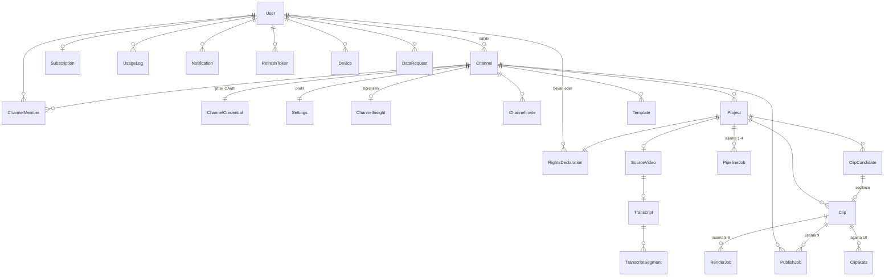
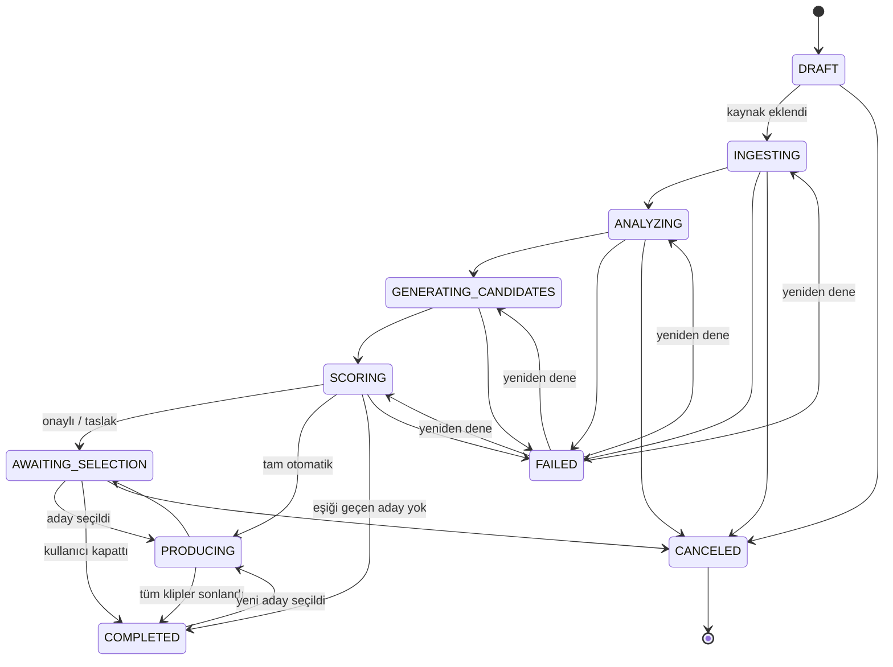
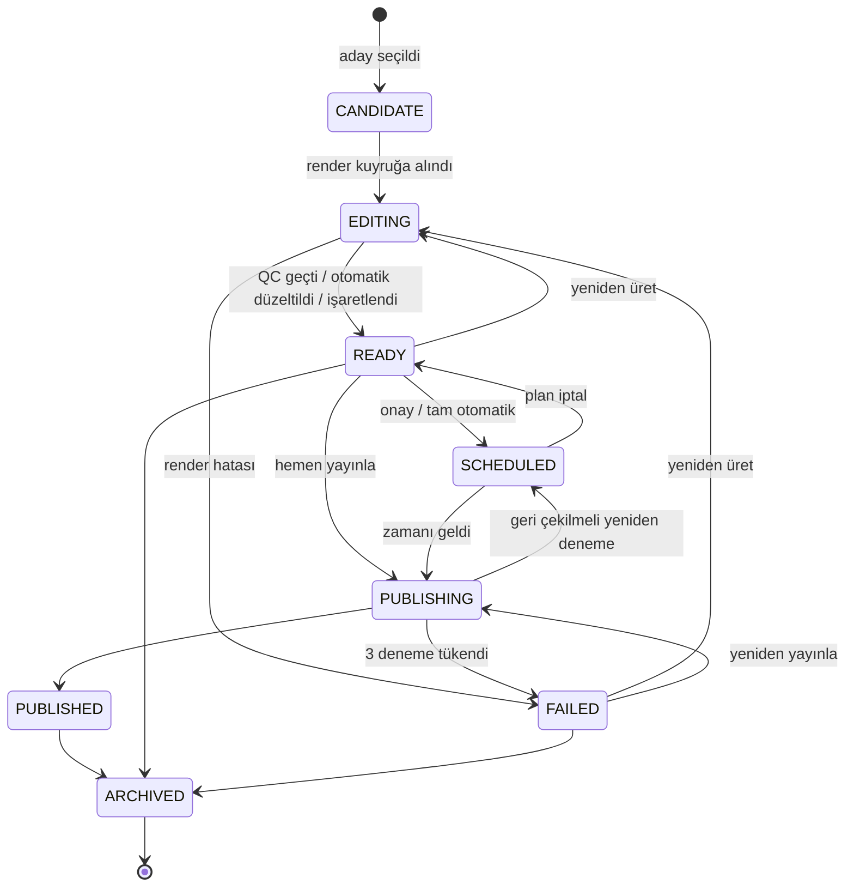
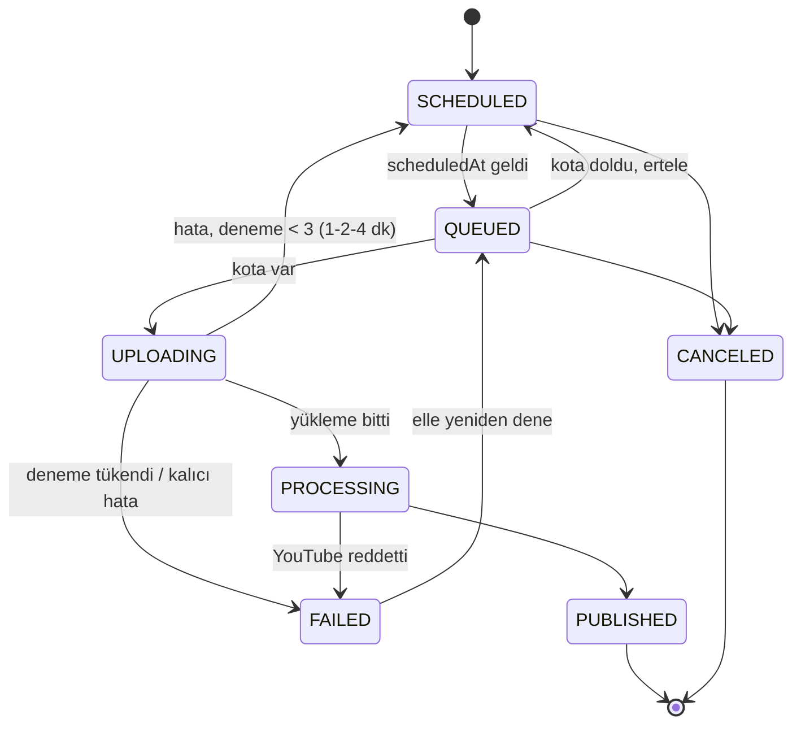

# KlipAI — Veri modeli

Yol: `klipai/docs/03-veri-modeli.md`

Şemanın kendisi: `apps/api/prisma/schema.prisma`. Geçiş tabloları: `packages/shared/src/state-machines.ts`.

## 1. İlişkiler

İstenen 14 varlığın tümü vardır. Eklenen destek tabloları ve nedenleri:

| Tablo | Neden |
|---|---|
| `RefreshToken`, `OneTimeToken`, `Device` | Token rotasyonu, e-posta doğrulama / parola sıfırlama, push hedefi |
| `ChannelCredential` | OAuth token'larını kanal satırından ayırmak (yanlışlıkla seçilmesin) |
| `ChannelMember`, `ChannelInvite` | Ekip rolleri |
| `TranscriptSegment` | Editörde metin düzeltme ve aralık sorgusu |
| `PipelineJob` | Proje düzeyi aşamaların kalıcı izi (RenderJob klip düzeyindedir) |
| `ClipStats`, `ChannelInsight` | Öğrenme döngüsü |
| `Notification`, `DataRequest`, `WebhookEvent`, `AuditLog` | Bildirim merkezi, KVKK, webhook idempotensi, denetim |

## 2. Durum makineleri

### Project

### Clip

Klip `READY` olduğunda `qcStatus` üç değerden birini taşır: `PASSED`, `AUTO_FIXED` veya `FLAGGED`.
`FLAGGED` klip tam otomatik modda bile planlanmaz; kullanıcı `acknowledgeQc` ile onaylamalıdır.

### PublishJob

Kalıcı hatalar (yeniden denenmez): `CHANNEL_REAUTH_REQUIRED`, `YOUTUBE_REJECTED`, `UPLOAD_LIMIT_EXCEEDED`.
Geçici hatalar (denenir): ağ, 5xx, `rateLimitExceeded`. Yükleme oturumu saklandığı için deneme kaldığı bayttan sürer.

### Diğerleri

| Makine | Durumlar | Not |
|---|---|---|
| SourceVideo | `PENDING → UPLOADING → UPLOADED → PROBING → READY` veya `PENDING → FETCHING → PROBING → READY`; her adımdan `FAILED` | |
| PipelineJob / RenderJob | `QUEUED → ACTIVE → SUCCEEDED \| FAILED \| CANCELED`; `ACTIVE → QUEUED` otomatik deneme | BullMQ işinin izdüşümü |
| ClipCandidate | `PROPOSED → SCORED → SELECTED \| REJECTED`; `REJECTED → SELECTED` | |
| Subscription | `TRIALING, ACTIVE, GRACE_PERIOD, PAST_DUE, CANCELED, EXPIRED` | RevenueCat olaylarıyla sürülür |

Geçişler tek bir yerde uygulanır: API `assertTransition` çağırır ve güncellemeyi
`WHERE id = ? AND status = <beklenen>` koşuluyla yapar; etkilenen satır 0 ise geçiş yarışı kaybedilmiştir ve iş yeniden okunur.

## 3. İndeksler

| Tablo | İndeks | Hizmet ettiği sorgu |
|---|---|---|
| `projects` | `(channelId, createdAt DESC)` | Proje listesi |
| `projects` | `(channelId, status)` | Panelde etkin projeler |
| `clip_candidates` | `(projectId, score DESC)` | Kesit listesi |
| `clips` | `(channelId, status, updatedAt DESC)` | Duruma göre klip listesi, onay bekleyenler |
| `clips` | `(channelId, scheduledAt)` | Takvim, boş yuva hesabı |
| `clips` | `(channelId, publishedAt DESC)` | İstatistik, en iyi klipler |
| `render_jobs` | `(clipId, kind, specHash)` | Aynı tarifle üretilmiş çıktıyı yeniden kullanma |
| `render_jobs`, `pipeline_jobs` | `(status, queuedAt)` | Takılı iş taraması |
| `publish_jobs` | `(status, scheduledAt)` | Zamanlayıcı taraması |
| `publish_jobs` | `(channelId, scheduledAt)` | Kanal takvimi, günlük adet sınırı |
| `usage_logs` | `(userId, periodKey, kind)` | Dönem kullanımı |
| `usage_logs` | `idempotencyKey` tekil | Çift faturalamayı önleme |
| `notifications` | `(userId, createdAt DESC)`, `(userId, readAt)` | Bildirim merkezi, okunmamış sayısı |
| `refresh_tokens` | `tokenHash` tekil, `(familyId)` | Yenileme, aile iptali |
| `transcript_segments` | `(transcriptId, startMs)` | Aralık sorgusu |
| `source_videos` | `(sha256)` | Aynı dosyanın analizini yeniden kullanma |

Göçle eklenecek, Prisma şemasında ifade edilemeyenler (aşama 2):

- `CREATE EXTENSION citext` (büyük/küçük harf duyarsız e-posta).
- Kısmi indeksler: `publish_jobs (scheduledAt) WHERE status = 'SCHEDULED'`, `notifications (userId) WHERE readAt IS NULL`.
- Kısmi tekil indeks: `publish_jobs (clipId) WHERE status IN ('SCHEDULED','QUEUED','UPLOADING','PROCESSING')` — bir klibin aynı anda tek etkin yayın işi olur.
- CHECK kısıtları: `clips.endMs > startMs`, `clip_candidates.score BETWEEN 0 AND 100`, `settings.minDurationSec <= maxDurationSec`.
- `rights_declarations` üzerinde UPDATE/DELETE'i engelleyen tetikleyici (değiştirilemez kayıt).

## 4. Kredi ve plan modeli

| | Ücretsiz | Pro | Ajans |
|---|---|---|---|
| Aylık klip | 5 | 150 | sınırsız |
| Aylık kredi (1 kredi = 1 kaynak dakikası) | 60 | 1.500 | 10.000 (adil kullanım) |
| Azami çözünürlük | 720p | 1080p | 4K |
| Kanal | 1 | 1 | 10 |
| Filigran | var | yok | yok |
| Ekip erişimi | yok | yok | var |
| Kuyruk önceliği | 10 | 5 | 1 |

Kredi miktarları ürün varsayımıdır (istenen "işlenen dakika bazlı" ölçüme göre seçildi) ve
`packages/shared` içindeki `ENTITLEMENTS` tablosundan tek yerden değiştirilir.

Akış:

1. **Ön denetim** (`initUpload` / `ingestFromLink`): beyan edilen süre kalan krediyi aşıyorsa 402 `INSUFFICIENT_CREDITS`.
2. **Düşüm** (aşama 1 sonu, ffprobe ile kesin süre): `UsageLog(MINUTES_PROCESSED, credits = −ceil(dakika), idempotencyKey = "minutes:{projectId}")`, aynı işlemde `Subscription.creditsUsed` artar.
3. **Klip sayacı** (aday seçimi): `UsageLog(CLIP_RENDERED, idempotencyKey = "clip:{clipId}")`. Aynı klibin yeniden üretimi sayaçtan düşmez.
4. **İade**: analiz kalıcı olarak başarısız olursa veya proje analiz bitmeden iptal edilirse `REFUND` satırı.
5. **Dönem yenileme**: RevenueCat `RENEWAL` olayı veya (Ücretsiz planda) aylık bakım işi sayaçları sıfırlar ve `CREDIT_GRANT` yazar. Kullanılmayan kredi devretmez.

Plan düşürme: mevcut planlı yayınlar korunur; sınırı aşan kanallar `ACTIVE` kalır ama yeni proje açılamaz (402 `PLAN_CHANNEL_LIMIT`), kullanıcı hangi kanalın etkin kalacağını seçer.

## 5. Saklama ve silme

| Veri | Saklama |
|---|---|
| Kaynak video (orijinal) | Proje tamamlandıktan 30 gün sonra silinir; proxy ve analiz çıktıları proje yaşadıkça kalır |
| Klip çıktıları | Proje silinene kadar |
| Yarım kalan parçalı yüklemeler | 48 saat (depolama yaşam döngüsü kuralı + bakım işi) |
| Hesap silme | 30 gün bekleme → kullanıcı, kanal, proje, depolama nesneleri silinir; Google token'ı iptal edilir |
| Silmeden muaf | `rights_declarations` (kullanıcı kimliği takma ada çevrilerek), `audit_logs` (kişisel veri içermez), yasal süre boyunca fatura kayıtları |
